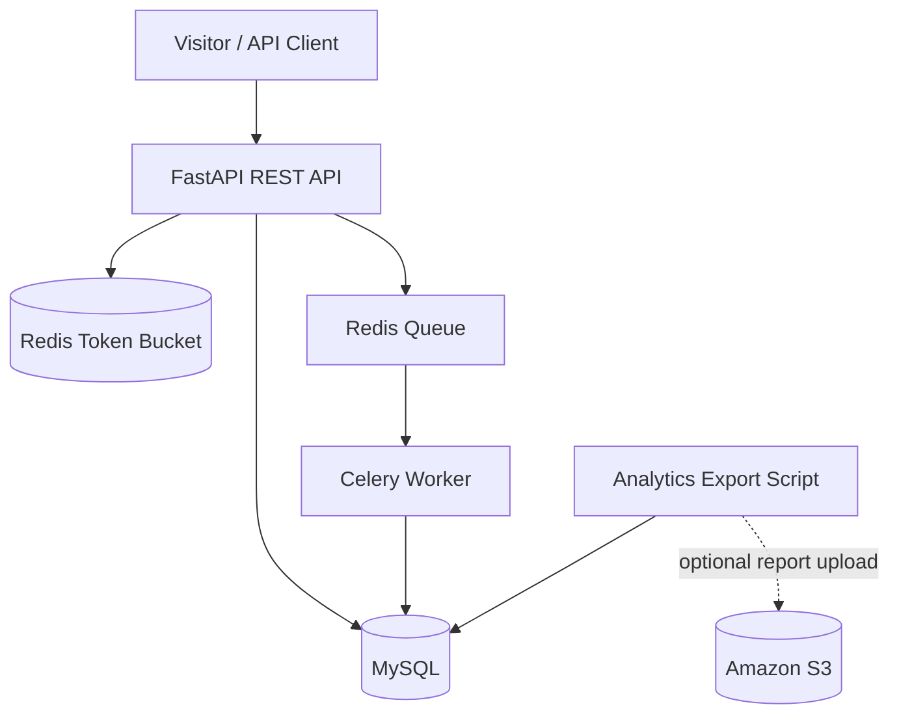

# LinkPulse — Distributed URL Shortener & Analytics Engine

A portfolio-ready backend project built with **Python, FastAPI, MySQL, Redis, Celery, Docker, and AWS deployment scaffolding**. It shortens URLs, protects API traffic with a distributed token-bucket rate limiter, and records click analytics asynchronously so redirects do not wait for analytics database writes.

<p align="left">
  
  
  
  
  
</p>

## What it demonstrates

- REST API design and validation with FastAPI and Pydantic.
- JWT-based user registration, login, and ownership checks.
- MySQL relational schema, foreign keys, uniqueness constraints, and query indexes.
- Random Base62 short codes with database-enforced uniqueness.
- Redis Lua token-bucket rate limiting shared across API instances.
- Asynchronous click processing using Celery and Redis.
- Optional country/city enrichment using a local MaxMind GeoLite2 database; raw IP addresses are not stored in the analytics table.
- Docker Compose for local development, Alembic migrations, pytest tests, GitHub Actions CI, load-test starter, and AWS Terraform scaffolding.

## Architecture



See [docs/architecture.md](docs/architecture.md) for request flows and scaling boundaries.

## Features

| Feature | Implementation |
|---|---|
| Register / login | Argon2 password hashing + JWT |
| Create a short link | Authenticated REST endpoint |
| Custom slug | Optional user-defined Base62-safe code |
| Generated slug | Random 8-character Base62 code |
| Expiration | Optional timestamp; expired links return HTTP 410 |
| Redirect | Indexed code lookup + HTTP 307 |
| Abuse prevention | Redis atomic token bucket, default capacity 60 and refill 1 token/second per IP |
| Click analytics | Celery background task; redirect is not blocked by the analytics insert |
| Analytics | Total clicks, last 30 days by date, top countries, top referrers |
| Reports | CSV export, optional S3 upload |

## Quick start (Docker Compose)

### Prerequisites

- Docker Desktop (or Docker Engine + Compose plugin)
- Git

### 1. Configure environment

```bash
git clone https://github.com/haady7/distributed-url-analytics.git
cd distributed-url-analytics
cp .env.example .env
```

For local development, the example values work. Change `SECRET_KEY` and all passwords before any deployment.

### 2. Start the stack

```bash
docker compose up --build -d
```

Compose starts MySQL and Redis, runs Alembic migrations, and then starts the API and Celery worker.

### 3. Open the API docs

- Swagger UI: http://localhost:8000/docs
- ReDoc: http://localhost:8000/redoc
- Liveness: http://localhost:8000/health/live

### 4. Try the API

Follow the commands in [docs/api-examples.md](docs/api-examples.md), or use this quick flow:

```bash
# Register
curl -X POST http://localhost:8000/api/v1/auth/register \
  -H 'Content-Type: application/json' \
  -d '{"email":"dev@example.com","password":"StrongPass!234"}'

# Login
curl -X POST http://localhost:8000/api/v1/auth/login \
  -H 'Content-Type: application/json' \
  -d '{"email":"dev@example.com","password":"StrongPass!234"}'

# Create a short URL (replace TOKEN with the returned access_token)
curl -X POST http://localhost:8000/api/v1/urls \
  -H 'Authorization: Bearer TOKEN' \
  -H 'Content-Type: application/json' \
  -d '{"original_url":"https://example.com/long/path","custom_code":"my-demo"}'

# Visit the returned short_url, then check analytics
curl -i http://localhost:8000/my-demo
curl http://localhost:8000/api/v1/urls/my-demo/analytics \
  -H 'Authorization: Bearer TOKEN'
```

The redirect returns immediately. The Celery worker stores click metadata asynchronously, so analytics may take a moment to reflect a newly recorded click.

## Run without Docker (optional)

Use Python 3.11+ and a local MySQL/Redis installation.

```bash
python -m venv .venv
# Windows PowerShell: .venv\Scripts\Activate.ps1
# macOS/Linux: source .venv/bin/activate
pip install -e ".[dev]"
cp .env.example .env
# Update DATABASE_URL and REDIS_URL for your local services
alembic upgrade head
uvicorn app.main:app --reload
```

In a second terminal, activate the environment and run:

```bash
celery -A app.analytics.celery_app:celery_app worker --loglevel=INFO
```

## Tests and code quality

```bash
pip install -e ".[dev]"
pytest
ruff check app tests scripts
```

Tests use an isolated in-memory SQLite database and disable the rate limiter. Production/local Compose uses MySQL and Redis.

## Load testing

Install the dev dependencies and run:

```bash
locust -f locustfile.py --host http://localhost:8000
```

The starter load test exercises health and OpenAPI endpoints. For realistic redirect throughput, create a test account/link and add a Locust task for that link. Do not load-test a third-party destination or an environment you do not own.

## Database design and indexes

- `users`: unique indexed email, hashed password, account state.
- `short_urls`: unique indexed code, indexed `(user_id, created_at)`, owner foreign key, optional expiry.
- `click_events`: indexed `(url_id, clicked_at)` for analytics aggregation, country index, URL foreign key.

Run `EXPLAIN` on the URL code lookup and click aggregation queries when experimenting with query plans. The short-code lookup uses the unique index; analytics filtering uses the composite index.

## AWS deployment

A Terraform starter and deployment walkthrough are included in [docs/aws-deployment.md](docs/aws-deployment.md) and `infra/terraform/`. **No AWS resources are created by this repository.** Review infrastructure and cost before applying. Store secrets in Parameter Store/Secrets Manager, keep RDS private, and serve the API behind HTTPS.

## Environment variables

| Variable | Purpose |
|---|---|
| `DATABASE_URL` | SQLAlchemy database URL |
| `REDIS_URL` | Redis URL used by rate limiter and Celery |
| `SECRET_KEY` | JWT signing secret (32+ chars in production) |
| `PUBLIC_BASE_URL` | Public origin used to build short links |
| `RATE_LIMIT_CAPACITY` | Token bucket capacity; default 60 |
| `RATE_LIMIT_REFILL_PER_SECOND` | Tokens replenished per second; default 1 |
| `RATE_LIMIT_FAIL_OPEN` | Local fallback on Redis failure; disable in production |
| `GEOIP_DB_PATH` | Optional local MaxMind `.mmdb` path |
| `S3_BUCKET` | Optional bucket for CSV report uploads |
| `AWS_REGION` | AWS region for S3 client |

## Security and known limitations

- The included development credentials are examples only. Rotate all secrets for real environments.
- The optional local rate-limit fallback is process-local. Redis is required for correct multi-instance enforcement. Behind a load balancer, configure trusted proxy handling to recover the real client IP; do not blindly trust arbitrary forwarded headers.
- GeoIP is approximate and requires you to obtain a GeoLite2 City database under its applicable terms. No IP geolocation provider is called by default.
- Click analytics are eventually consistent because they are queued. Monitor the Celery queue and dead-letter/retry behaviour in a production deployment.
- A public URL shortener needs abuse controls beyond basic per-IP rate limiting: domain reputation checks, blocklists, abuse reports, phishing detection, and operational response.
- This is a learning/portfolio implementation, not a claim of a benchmarked production system. Measure performance in your own environment before stating latency or throughput numbers.

## Suggested resume bullets (use only after you run and verify the project)

- Built a FastAPI-based URL shortener with JWT authentication, URL expiry, indexed MySQL persistence, and Redis-backed token-bucket rate limiting.
- Implemented asynchronous click analytics using Celery and Redis so redirect requests do not wait for analytics database writes; added aggregate reporting and CSV/S3 export.
- Containerized the API, MySQL, Redis, and worker with Docker Compose; added Alembic migrations, automated tests, CI, and AWS deployment scaffolding.

## Repository structure

```text
app/                  FastAPI application, models, auth, URL APIs, rate limiter
migrations/           Alembic schema migration
tests/                pytest suite
docs/                 Architecture, API examples, AWS guide
infra/terraform/      AWS infrastructure starter
scripts/              Analytics CSV/S3 export
.github/workflows/    GitHub Actions CI
Dockerfile            API/worker image
docker-compose.yml    Local MySQL + Redis + API + worker
locustfile.py         Load-test starter
```

## License

MIT — see [LICENSE](LICENSE).
