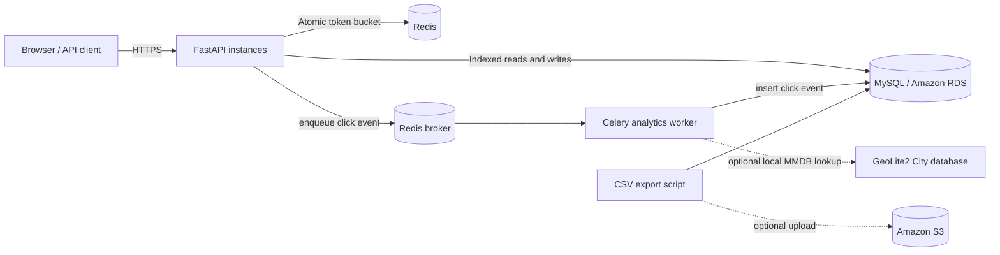

# Architecture

## Request paths

1. A user registers and receives a signed JWT after login.
2. An authenticated user creates a short URL. The API validates the target URL, stores a globally unique code, and returns the public redirect URL.
3. A visitor requests `/{code}`. The API performs one indexed lookup, checks active/expiry state, queues a small analytics message, and returns a temporary redirect.
4. A Celery worker consumes the message and stores the click event separately. The redirect does not wait for the analytics insert.
5. The owner requests analytics. Aggregations use the `(url_id, clicked_at)` index.

## Scaling boundaries

- Run multiple stateless API containers behind an HTTPS load balancer.
- Redis is shared by every API instance, so the token bucket is distributed rather than process-local.
- Run Celery workers independently and scale worker concurrency based on queue depth.
- MySQL owns durable URL and analytics data. Use managed RDS backups and monitor connection-pool limits.
- For very high click volume, partition `click_events` by time or stream events through a managed queue before writing to an analytical store.

## Important implementation choices

- The short code is randomly generated from Base62 characters, with a unique database constraint as the final collision guard. The `encode_base62` helper is included for learning and deterministic encoding; IDs are not exposed as predictable URL codes.
- Redirects use HTTP 307 so the original request method is preserved. The public redirect endpoint is read-only for URL data.
- IP addresses are not stored in click rows. The worker stores a SHA-256 IP hash and optionally resolves country/city using a locally supplied MaxMind GeoLite2 City database.
- The development rate limiter can fall back to in-process memory when Redis is unavailable. This fallback is not distributed and must not be relied on in production.
- GeoIP is optional and approximate. It is not GPS-level location; follow local privacy rules and publish an appropriate retention/privacy notice.
